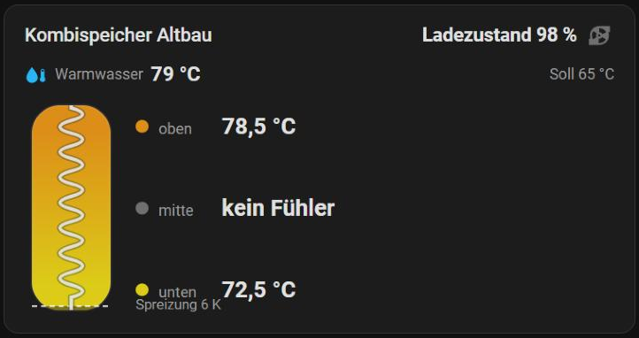

# Puffer-Karte

Pufferspeicher mit Temperaturverlauf, Ladezustand und Pumpe



## Installation

### Über den Marketplace (Home Assistant 2026.11 und neuer)

1. **Einstellungen** → **Marketplace** → **Aus Link hinzufügen**.
2. Die Adresse dieses Repositorys eintragen, Kategorie **Dashboard**.
3. **Puffer-Karte** installieren. Die Ressource wird dabei automatisch eingetragen.

### Über HACS (ältere Versionen)

**HACS** → ⋮ → **Benutzerdefinierte Repositories** → Adresse dieses Repositorys, Typ **Dashboard** → installieren.

### Manuell

`puffer-karte.js` nach `/config/www/` kopieren und unter **Einstellungen** → **Dashboards** → ⋮ → **Ressourcen**
als JavaScript-Modul `/local/puffer-karte.js` eintragen.

## Verwendung

```yaml
type: custom:puffer-karte
```

## Konfiguration

```
Puffer-Karte: zeichnet einen Pufferspeicher mit Temperaturverlauf (oben warm, unten kalt),
Ladezustand und Pufferpumpe.

  type: custom:puffer-karte
  titel: Puffer Altbau
  oben: sensor.puffer_temperatur_oben
  mitte: sensor.puffer_temperatur_mitte   # optional
  unten: sensor.puffer_temperatur_unten
  ladezustand: sensor.puffer_ladezustand  # optional, %
  pumpe: sensor.puffer_pufferpumpen_ansteuerung  # optional (% oder an/aus)
  min: 20, max: 90          # optional, Farbskala blau..rot in °C
  ungueltig_ab: 120         # optional, Werte darueber gelten als "kein Fuehler"
  waerme: sensor.puffer_altbau_warmeinhalt              # optional, kWh
  leistung: sensor.puffer_altbau_leistung_netto         # optional, kW (+ laden / - entladen)
  entnahme_heute: sensor.puffer_altbau_entnahme_heute   # optional, kWh
  entnahme_gesamt: sensor.puffer_altbau_entnahme_gesamt # optional, kWh
```

## Lizenz

MIT
